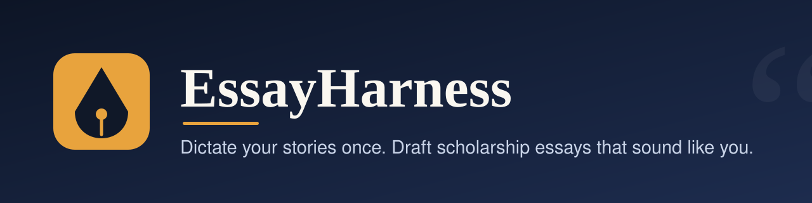
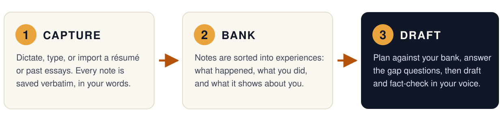

<p align="center">
  
</p>

<p align="center">
  <a href="https://github.com/edtpui/essayharness/releases/tag/v0.3.0"></a>
  <a href="LICENSE"></a>
  <a href="https://github.com/edtpui/essayharness/releases"></a>
  <a href="https://github.com/edtpui/essayharness/stargazers"></a>
  
</p>

<p align="center">
  <strong>Your scholarship essays, written from your own stories, in your own voice, on your own machine.</strong>
</p>

Dictate your life experiences once and keep them in a local **experience bank**. When a scholarship prompt lands, the essay agent plans against your bank, asks you about the specifics it doesn't have yet, and drafts only what your own material supports. No invented achievements, no generic AI voice, and your notes never live on someone else's server.

Your own API keys, dictation streamed straight from your browser, plain-file local storage, and an agent that asks questions instead of guessing.

## Download

| Platform | Get it |
| --- | --- |
| Windows | [EssayHarness.Setup.0.3.0.exe](https://github.com/edtpui/essayharness/releases/download/v0.3.0/EssayHarness.Setup.0.3.0.exe) |
| macOS (Apple Silicon) | [EssayHarness-0.3.0-arm64.dmg](https://github.com/edtpui/essayharness/releases/download/v0.3.0/EssayHarness-0.3.0-arm64.dmg) |
| macOS (Intel) | [EssayHarness-0.3.0.dmg](https://github.com/edtpui/essayharness/releases/download/v0.3.0/EssayHarness-0.3.0.dmg) |
| Docker | `docker pull ghcr.io/edtpui/essayharness:0.3.0` |

Builds are currently unsigned, so Windows SmartScreen and macOS Gatekeeper will warn on first launch. On Windows, click **More info**, then **Run anyway**. On macOS, follow the steps below. See the [v0.3.0 release](https://github.com/edtpui/essayharness/releases/tag/v0.3.0) for details.

### First launch on macOS

EssayHarness is not signed with an Apple Developer certificate yet, so Gatekeeper blocks the first launch. That is expected; the app is safe to open if you downloaded it from the releases page above.

1. Open the `.dmg` and drag **EssayHarness** into your **Applications** folder. Launch it from Applications, not from inside the DMG.
2. macOS shows a warning that Apple could not verify the app, or that it is from an unidentified developer. Click **Done**. Do not click Move to Trash.
3. Open **System Settings**, then **Privacy & Security**, and scroll down to the Security section. There is a note that EssayHarness was blocked, with an **Open Anyway** button.
4. Click **Open Anyway**, confirm with Touch ID or your password, then click **Open Anyway** again in the dialog that follows.
5. EssayHarness launches. Later launches open normally, with no warning.

If the **Open Anyway** button does not appear, or macOS says the app is "damaged and can't be opened" (that message usually just means the download is quarantined, not that the file is broken), remove the quarantine flag in Terminal instead:

```sh
xattr -dr com.apple.quarantine /Applications/EssayHarness.app
```

Then launch the app normally. A fresh download of a new version is quarantined again, so repeat one of these two routes for each new release until the builds are signed and notarized.

## Why EssayHarness

- **Grounded, not generated.** Drafts are built only from your bank and your answers. A built-in fact check lists anything a draft claims that your material doesn't support.
- **Your voice.** The drafter writes from your dictated notes, your saved quotes, and writing samples you mark, so essays read like you on your best day.
- **Local first.** Everything is plain files in one folder on your machine. Bring your own model key, or run fully local models through Ollama and nothing but dictation leaves the machine.
- **One bank, every application.** Tell a story once and reuse it across every scholarship, personal statement, and application prompt that asks for it.
- **25+ model providers.** Claude, OpenAI, Gemini, OpenRouter, and many more, plus any OpenAI-compatible endpoint.

## How it works

<p align="center">
  
</p>

1. **Capture.** Talk through a story (or type, or import a résumé or past essay as `.txt`, `.md` or `.pdf`). Every note is saved first, then sorted in the background into **experiences**: what happened, what you did, outcomes, reflections, skills shown, people, and short quotes in your own words. *Interview me* asks about the themes your bank is missing (setbacks, leadership, service, goals, background…).
   **Upload essays and stories** (`.docx`, `.pdf`, `.txt`, `.md`, up to 20 at once, or drag them in): each is added to the bank and gets a candid review from the coach — what works, what's weak, how to strengthen it, and which prompts it could answer.
2. **Experience bank.** Review and correct everything the agent extracted. Essays only use what's in the bank and in your answers, so fixing a wrong detail here fixes every future draft. *About you* holds facts every essay can use.
   **Graph** shows every experience linked by the qualities and people they share, the essays that use them and the documents they came from. Zoom, pan, filter, search, and click a node to see its connections.
3. **Essays.** Paste the prompt, the length limit and the scholarship's criteria, then work on the essay in a **chat**: tell it stories, details you forgot, or what to change, by dictation or typing. Each message is kept, saved to your bank when it says something about you, and the coach replies and plans, drafts, revises or fact-checks as needed. The draft panel beside the chat always shows the current version.
   - **Plan:** the agent proposes two or three angles, outlines them against specific experiences, and lists the **gap questions** the essay needs answered.
   - **Questions:** answer by dictation or typing; answers go into the bank too. Re-plan to let it check for anything else.
   - **Draft:** streamed live, in your voice (it uses your quotes, dictated notes and any writing samples you mark), within the limit.
   - **Revise** in your own words ("open with the night shift"), **Cut to limit**, **Edit** by hand, and **Check facts**, which lists anything in the draft your material doesn't support and highlights it.
   Every version is kept.

## Run it from source

Requires Node.js 20.9 or newer.

```powershell
npm install
npm run dev
```

Open http://127.0.0.1:3400 and add your keys in **Settings**:

- **Anthropic** for Claude (the default writing model is `claude-opus-5-5`), or any of the other API-key providers available (OpenAI, Google Gemini, OpenRouter, xAI, Mistral, DeepSeek, Groq, Together, Fireworks, Cerebras, Hugging Face, NVIDIA, Baseten, Vercel AI Gateway, OpenCode, Meta, Moonshot, Kimi, MiniMax, Z.AI, Ant Ling, Qwen and Xiaomi token plans), or any **OpenAI-compatible endpoint** — e.g. Ollama at `http://localhost:11434/v1` for fully local models. A second, cheaper model can be set for sorting notes.
- **Deepgram** for dictation. The key needs **Member** permission or higher, because the app mints short-lived browser tokens from it (`/v1/auth/grant`); audio goes from the browser to Deepgram directly and never through this server.

For a production build: `npm run build` then `npm start` (both bind to 127.0.0.1:3400).

Keys can also come from environment variables (see `.env.example`); a key saved in Settings wins.

## Your data

Everything lives in one folder, `%USERPROFILE%\.essayharness` by default (set `SE_DATA_DIR` to move it). It lives outside the project folder on purpose, so tools or containers that can read your code don't see your notes and keys. Upgrading from v0.1.0: the folder was called `.scholarship-essays` before the rename; on first launch the app moves your existing folder to the new name automatically, so your bank comes with you.

| Path | Contents |
| --- | --- |
| `entries/` | every note and answer, verbatim |
| `experiences/` | the bank |
| `essays/` | briefs, plans, questions, every draft version, the latest fact check |
| `profile.json`, `interview.json`, `settings.json` | as named |
| `credentials.json` | API keys (never sent to the browser) |
| `usage.jsonl` | one line per model call, with estimated cost for Claude models |

Storage is local, processing is not: notes and drafts go to whichever model provider you choose, and dictation audio goes to Deepgram. With an Ollama model nothing but dictation leaves your machine.

Check each scholarship's rules on AI assistance before submitting. The app is built to keep essays factual and in your voice, but you are the author of record.

## Using it from your phone or another device

The server only listens on 127.0.0.1 and refuses API requests addressed to unknown host names (DNS-rebinding protection) or coming from other origins. To use it over Tailscale, keep it on loopback and publish it with `tailscale serve` (HTTPS, which the browser also requires for microphone access), then add the machine's names to `SE_ALLOWED_HOSTS`, for example in `.env.local`:

```
SE_ALLOWED_HOSTS=my-pc,my-pc.your-tailnet.ts.net
```

## Docker

`docker compose up -d --build` builds a standalone image, keeps data in the `essayharness_data` volume, and publishes on `127.0.0.1:3400`. From inside the container, Ollama on the host is `http://host.docker.internal:11434/v1`.

## Development

```powershell
npm test          # unit + integration tests against a local fake Anthropic/OpenAI server
npm run typecheck
npm run build
```

| Area | Where |
| --- | --- |
| Model instructions (all prompts) | `server/prompts.ts` |
| Providers: Claude (official SDK, refusal fallbacks, prompt caching), OpenAI-compatible | `server/llm/` |
| Notes → bank extraction and merge rules | `server/bank.ts` |
| Plan, draft, revise, fact check | `server/essays.ts` |
| File storage (atomic writes, per-record locks) | `server/store.ts`, `server/db.ts` |
| API guard (host / origin checks) | `proxy.ts`, `server/security.ts` |
| Dictation (AudioWorklet → Deepgram WebSocket) | `components/dictation.tsx`, `public/worklets/pcm-capture.js` |
| Pages | `components/pages/` |

With Claude models the app sends `fallbacks: "default"` (beta `server-side-fallback-2026-07-01`), so a request that the requested model declines is retried server-side on a fallback model instead of failing.

## Contributing

Issues and pull requests are welcome. See [CONTRIBUTING.md](CONTRIBUTING.md) for how to set up a dev environment and what makes a good pull request, and [SECURITY.md](SECURITY.md) for reporting vulnerabilities.

## License

[AGPL-3.0](LICENSE). If you run a modified version of EssayHarness as a network service, you must make your source available to its users.

## Credits

Inspired by [LearnHarness](https://github.com/amosblomqvist/learnharness).
